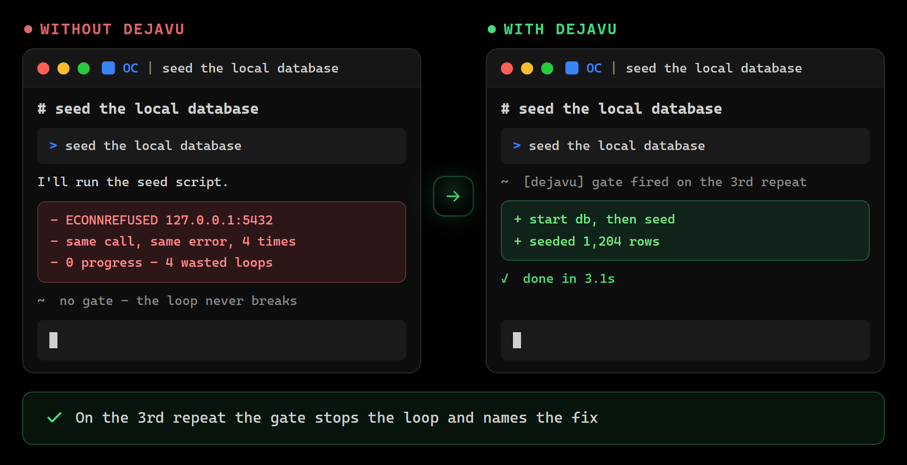

> [!IMPORTANT]
> **[`opencode-dejavu`](https://github.com/WhiteBite/opencode-dejavu) переименован в [`dejavu-gates`](https://github.com/WhiteBite/dejavu-gates) — вы на новом доме.**
> Старый URL [github.com/WhiteBite/opencode-dejavu](https://github.com/WhiteBite/opencode-dejavu) навсегда редиректит сюда.
> - **Конфиг OpenCode:** `{ "plugin": ["opencode-dejavu"] }` → `{ "plugin": ["dejavu-gates"] }`
> - **git remote:** `git remote set-url origin https://github.com/WhiteBite/dejavu-gates.git`
> - **npm:** старый пакет [`opencode-dejavu`](https://www.npmjs.com/package/opencode-dejavu) объявлен устаревшим и заморожен на 2.27.0; все релизы начиная с 2.39.0 — это [`dejavu-gates`](https://www.npmjs.com/package/dejavu-gates)

<p align="center">
  
</p>

<h1 align="center">dejavu — error gates для AI-кодинг-агентов</h1>

<p align="center"><a href="README.md">English</a> | <b>Русский</b></p>

<p align="center">
  
  
  
  
</p>



Агенты повторяют одни и те же ошибки, потому что забывают их между сессиями — и markdown-правила это не лечат. dejavu — **протез памяти с зубами** поверх сессий: механически детектирует повторяющиеся сбои вызовов инструментов (bash, read, edit, write, glob, grep), промоутит их в принудительные гейты, учит агента напоминанием, блокирует повторное нарушение в той же сессии — и **замыкает цикл**: команда починена и стабильно проходит → гейт лечится (heal) и уходит на пенсию. Один движок, много хостов: OpenCode (плагин), Claude Code, Codex CLI, Gemini CLI, Cursor, Copilot CLI, Crush, Devin CLI, Kiro (hook-handler CLI), Cline (встроенный плагин). TypeScript + Bun, поставляется как исходники, без шага сборки.

Полная механика — в [docs/reference.md](docs/reference.md) (EN); этот README несёт суть.

## Быстрый старт

**OpenCode** (ставится автоматически при старте; V1 использует ключ `plugin`, V2 переименовал его в `plugins`):

```jsonc
// ~/.config/opencode/opencode.json (глобально) или opencode.json (проект)
{ "plugin": ["dejavu-gates"] }   // OpenCode V1 — или { "plugins": ["dejavu-gates"] } на V2
```

**Любой другой харнесс** — одна команда, сама находит установленные харнессы, project-scope:

```bash
npx -y dejavu-gates install      # добавь --user для юзер-скопа; npx -y dejavu-gates hooks --check для проверки
```

Ничего настраивать не нужно. Гейты появляются сами по мере сбоев — первое напоминание сработает после третьего сбоя одного паттерна в двух сессиях.

Опционально, потом: [подкрутить чему агент учится](#наблюдаемость) (`dejavu lesson`), [читать стор](#файлы-данных) или включить opt-in [recovery-каналы](#recovery-каналы-opencode-opt-in).

## Как это работает

```
вызов упал        →  сигнатура нормализуется (пути/числа/хеши параметризуются)
                  →  pattern-key считается, сессии трекаются
                  →  3 сбоя в 2 разных сессиях → гейт создан (promoted)
следующая попытка →  [dejavu] REMINDER (вызов прерван, агент видит коррекцию)
повтор упал       →  повторное нарушение в той же сессии → жесткий BLOCK
диагностич. cmd   →  гейт остаётся remind-only: вызов ВЫПОЛНЯЕТСЯ, напоминание
                     едет на падающий вывод как [dejavu] NOTE (раз за сессию)

цикл замыкается на поведении, в обе стороны:
  починенная команда стабильно проходит → 3 успеха → гейт ЛЕЧИТСЯ (heal)
  агент продолжает бороться с гейтом     → recurrence / dejavu:proceed → ДЕМОУТ
  60 дней без повторения                 → гейт истекает (expire)
```

Решения дизайна (пост-мортем существующих подходов):

- **Сначала напоминаем, блокируем при повторе.** Чистый блок начинает arms race — агент обходит гейты (`npm` заблокирован → берёт `pnpm`). Напоминание с коррекцией учит; блок прибережён для проигнорированных напоминаний.
- **Сообщения гейта — учителя.** Каждое несёт `CORRECTION:` (что делать вместо) и `EVIDENCE:` (N сбоев в M сессиях), а не голый запрет.
- **Только механические pattern-keys.** Никакой LLM-классификации ошибок в hot path — ненадёжный компонент не занимается работой про надёжность.
- **Два скопа.** Особенности конкретного репозитория живут в `<repo>/.opencode/dejavu/` (коммитабельно); паттерны из 2+ директорий проектов — агентовские привычки, переезжают в `~/.config/opencode/dejavu/`. Глобальный индекс (`index.json`) считает директории проектов по каждому ключу и двигает эскалацию.
- **У принуждения есть отрицательная обратная связь.** Гейт, с которым агент продолжает бороться, демоутится сам и механически больше не промоутится; одна упрямая сессия не может разоружить гейт (оба голоса требуют разных сессий). Человек всегда может вернуть гейт вручную — см. [gates.json](#как-выглядит-гейт).
- **Нет identity — нет зубов.** Сигнатура, из которой нормализация выжала всю суть (`cmd <path> <str>`, `node <str>`), совпадает с целым семейством команд и не может принуждать — только watch.
- **Fail-open, всегда.** Hook CLI никогда не клинит хост: битый payload, сломанный стор или внутренний баг dejavu дают `{}` + exit 0. stdout несёт только decision JSON, остальное — в stderr.

## Как выглядит гейт

`gates.json` — обычный редактируемый человеком JSON: удалил объект — гейт отключён, поправил `correction` — учишь лучшему:

```jsonc
// <repo>/.opencode/dejavu/gates.json
{
  "key": "bash:deploy-to-staging88f",        // pattern key — идентичность гейта
  "signature": "bash:deploy --to <path> --env <str>",  // нормализованная форма вызова
  "tool": "bash",
  "status": "blocking",                      // blocking | reminding | watching
  "count": 4,                                // сбои за всё время
  "sessions": ["s1", "s2"],                  // разные сессии, в которых был сбой
  "snippet": "Error: unknown flag --env",     // пойманное доказательство (секрет заскраблен)
  "correction": "Last error: \"unknown flag --env\" — используй --environment.",
  "recurredAfterGate": 0,                    // ГЛАВНАЯ метрика: пережила ли ошибка напоминание
  "firstSeen": "2026-08-21T10:00:00.000Z",
  "lastSeen": "2026-09-29T18:12:00.000Z"
}
```

## Сценарии использования

- **Команда, падающая из сессии в сессию.** После 3 сбоев в 2 разных сессиях гейт создаётся; следующая попытка прерывается с напоминанием `CORRECTION:`, повтор после неудачного напоминания — блок.
- **Падающая диагностика обязана продолжать работать.** `tsc`, `pytest`, `cargo test` и прочая диагностика промоутится в `reminding` — вызов выполняется, `[dejavu] NOTE` раз за сессию едет на падающий вывод, ничего не прерывается.
- **Повторяющиеся фейлы файл-проб.** Чтение недостающих файлов и отвергнутые правки собираются в `watching`-гейты — измеримы, видны в отчётах, никогда не прерывают.
- **Foreground-серверы, оставляющие сироты.** Старт `npm run dev`, `uvicorn`, `next dev` прерывается в before-hook с коррекцией «запусти detached» (tmux / `nohup … &`).
- **Одна привычка — каждый харнесс.** Сигнатуры нормализуются до хеширования: один и тот же падающий вызов гейтится в любом хосте, разделяющем стор.
- **Курирование того, что говорят агенту.** `dejavu lesson list` показывает гейты на машинных дефолтных коррекциях; `lesson set` заменяет их человеческими.

## Why choose this — почему выбирают это

- **Обучение и принуждение в одном цикле.** Обзор ~60 OSS-проектов (сен 2026) не нашёл отгруженного инструмента, который и учит правила из наблюдаемых сбоев, и блокирует вызовы — policy-движки никогда не учатся, memory-плагины никогда не блокируют ([детали и оговорки](#сравнение-с-аналогами)).
- **Механический hot path.** Промоушен решают подсчёт pattern-keys и fuzzy-merge Levenshtein ≤ 0.3 — без LLM в пути сбоя.
- **Гейты отвечают за поведение.** 3 рекурренции после гейта или 3 явных обхода демоутят гейт; 3 успеха подряд лечат; 60 дней без повторения истекают.
- **Один стор, 10 харнессов.** OpenCode, Claude Code, Codex CLI, Gemini CLI, Cursor, Copilot CLI, Crush, Devin CLI, Kiro и Cline читают и пишут одни и те же гейты.

## Кому это нужно

- **Соло-разработчикам с плотной agents-нагрузкой** — гейты копятся из твоего собственного `log.jsonl`, принуждение соответствует твоей реальной истории сбоев, а не генерическому rulebook.
- **Мульти-харнесс пользователям** — один стор на все поддерживаемые хосты.
- **Командам, которым нужно принуждение без рукописной политики** — гейты промоутятся механически по рекуррентности и демоутятся сами, когда агент перестаёт бороться; люди правят только коррекции.

## Поддерживаемые харнессы

| Харнесс | Установка | Блок (pre) | Remind NOTE (post) | Примечания |
|---|---|---|---|---|
| **OpenCode** | npm plugin / source | ✅ | ✅ | полная интеграция: все каналы, repeat guard, контекст компакции |
| **Claude Code** | `install-hooks.ts` | ✅ | ✅ | аннотации через `additionalContext`; хук `SessionStart` вносит дайджест гейтов (топ enforced-гейтов) в начале сессии; хуки не несут exit codes → текстовая детекция |
| **Codex CLI** | `install-hooks.ts` | ✅ | ✅ | хуки стабильны и включены по умолчанию; Pre/PostToolUse срабатывают на каждый инструмент; для project hooks может остаться trust prompt первого запуска |
| **Gemini CLI** | `install-hooks.ts` | ✅ | ✅ | BeforeTool/AfterTool |
| **Cursor** | `install-hooks.ts` | ✅ | ✅ | shell events + CC-совместимые events |
| **Copilot CLI** | `install-hooks.ts` | ✅ | ✅ | camelCase + PascalCase семейства payload |
| **Crush** | `install-hooks.ts` | ✅ | ❌ деград | в upstream только PreToolUse — принуждение + общий стор всё равно защищают; без post-аннотаций |
| **Devin CLI** | `install-hooks.ts` | ✅ | ✅ | merge root-событий в `.devin/hooks.v1.json`; Claude-формат хуков также авто-импортируется из `.claude/settings.json` |
| **Kiro** | `install-hooks.ts` | ✅ | ✅ | `.kiro/hooks/dejavu-gates.json`; NOTE едет сырым в stdout хука (контекст-канал Kiro); только project scope |
| **Cline** | `cline plugin install --npm dejavu-gates` | ✅ | ✅ | встроенный хост плагина (`src/cline-plugin.ts`); только SDK/CLI/Kanban; без exit codes → текстовая детекция |
| Zed, Aider | — | ❌ | ❌ | нет hook API для перехвата вызовов инструментов — не переносимо |
| Windsurf, Amp | — | (planned) | ❌ | block-only / fire-and-forget; отложено до появления context injection |

**Единый стор — гейты переезжают между харнессами.** Каждый хост читает/пишет один и тот же стор (`<repo>/.opencode/dejavu/` + `~/.config/opencode/dejavu/`, `DEJAVU_HOME` переопределяет). Сигнатуры нейтральны к харнессу (имена инструментов и поля аргументов нормализуются до подписи) — гейт, выученный в Claude Code, срабатывает в OpenCode, Cursor и везде, где есть этот стор.

## Установка

Пререквизит для любого пути: [Bun](https://bun.sh) в PATH (hook-хендлеры крутят сырой TypeScript; без шага сборки).

Установщик идемпотентно мержится в конфиг каждого харнесса (чужие хуки и поля выживают), бекапит файл в `<config>.dejavu-bak` перед изменением, отказывается трогать непарсебельные конфиги и пишет hook-команды, зовущие CLI установленного пакета напрямую (никакого `npx` в hot path — хуки стреляют на каждый вызов). Либо поставь пакет один раз (`npm i -g dejavu-gates` или `npm i -D dejavu-gates`) и используй команду `dejavu` / `dejavu-gates` вместо `npx -y`.

<details>
<summary><b>Нативные plugin-каналы, зеркало GitHub Packages, OpenCode из исходников, ручной вызов</b></summary>

Нативные plugin-каналы (без npx, авто-обновление):

| Харнесс | Команда |
|---|---|
| Claude Code | `claude plugin marketplace add WhiteBite/dejavu-gates`, затем `claude plugin install dejavu-gates@dejavu-marketplace` |
| Codex CLI | `codex plugin add WhiteBite/dejavu-gates` (хуки включены по умолчанию; подтверди trust prompt, если появится) |
| Copilot CLI | `copilot plugin install WhiteBite/dejavu-gates` |
| Cursor | IDE: `/add-plugin` → marketplace → dejavu-gates (или скопируй репо в `~/.cursor/plugins/local/dejavu-gates`) |
| Gemini CLI | `gemini extensions install https://github.com/WhiteBite/dejavu-gates` |
| Crush / Devin / Kiro / Cline | нет plugin marketplace — используй установщик выше, для Cline — `cline plugin install --npm dejavu-gates` |

Компэньон-протокол (`skills/dejavu/`) едет внутри plugin-бандла и авто-дискаверится плагин-форматами Claude Code, Cursor и Gemini CLI.

GitHub Packages (автентифицируемое зеркало, `@whitebite/dejavu-gates`) и нужный ему `.npmrc` — см. [reference — harness installation notes](docs/reference.md#harness-installation-notes).

OpenCode из исходников:

```bash
git clone https://github.com/WhiteBite/dejavu-gates ~/.config/opencode/vendor/dejavu
cd ~/.config/opencode/vendor/dejavu && bun install
```

```ts
// ~/.config/opencode/plugins/dejavu.ts
export { Dejavu } from "../vendor/dejavu/index.ts"
```

Компэньон-skill (протокол поведения агента): скопируй `skills/dejavu/` в `~/.config/opencode/skills/dejavu/`.
Статус-команда: скопируй `commands/dejavu.md` в `~/.config/opencode/command/dejavu.md` (Claude Code, Cursor и Gemini CLI подхватят ту же команду из plugin-бандла автоматически).

Ручная установка / из клона (все харнессы):

```bash
git clone https://github.com/WhiteBite/dejavu-gates && cd dejavu-gates && bun install
bun scripts/install-hooks.ts --harness claude            # project scope (cwd)
bun scripts/install-hooks.ts --harness claude --user     # юзер-scope (~/.claude/...)
bun scripts/install-hooks.ts --harness codex --dry-run   # предпросмотр без записи
```

</details>

## Как он себя ведёт

**Политика блокировки.** Блокирующими бывают только `bash`-команды, НЕ являющиеся диагностикой. Диагностика и итерационные команды (`tsc`, `pytest`, `cargo test`, `go build`, `dart run`…) промоутятся в `reminding` — аннотируют падающий вывод и никогда не блокируют. Файл-пробы (read/edit/write/glob/grep) остаются `watching`: измеримы, никогда не прерывают. `canBlock()`/`canRemind()` в `src/patterns.ts` — единственный источник истины.

**Проактивные guard'ы** — пять прерываний по форме в before-hook (foreground-старты dev-серверов, spawn-паттерны, вешающие вызов, осиротевший `Start-Job`, снежный ком наращиваемых команд). Каждый учит конкретной альтернативе и обходится через `# dejavu:proceed` (логируется). Полная механика: [reference — proactive guards](docs/reference.md#proactive-guards).

**Payload-гигиена (только OpenCode)** — stateless-проход transform-hook по исходящему payload: подряд идущие одинаковые вызовы инструментов санитизируются, третий — жёстко блокируется (превентит DashScope HTTP 400 на идентичный вызов, отравляющий сессию), повторяющиеся формы получают advisory-заметку, а модель, застрявшая на повторении заблокированного вызова, получает автоматический synthetic user-ход, завершающий цикл. Детали: [reference — payload hygiene channels](docs/reference.md#payload-hygiene-channels).

**Безопасность данных** — управляющие символы терминала и секреты скраббятся до касания диска; мутации гейтов идут под эксклюзивным lockfile c tmp+rename-записью; непарсебельный `gates.json` уходит в карантин (байты сохраняются) и механически ремонтируется на следующем init; временно нечитаемый стор бросает исключение вместо парсинга как пустого. Полная механика: [reference — data safety](docs/reference.md#data-safety).

**Жизненный цикл гейта** — гейты лечатся (3 успеха подряд), уходят на пенсию как taught (5+ напоминаний без рецидива), как chronic, демоутятся, когда агент борется, истекают после 60 дней без повторения; promoted-гейт всегда несёт механическую дефолтную коррекцию по семейству команды — гейт не ждёт человека в состоянии «NOT TEACHING». Детали: [reference — gate lifecycle](docs/reference.md#gate-lifecycle).

### Recovery-каналы (OpenCode, opt-in)

Два прохода для дегенерации на стороне провайдера, оба выключены по умолчанию (`1`/`true`/`yes` для включения). Без гейтов, без персистентности, без промоушена — полная механика в [reference](docs/reference.md#recovery-channels-opencode-opt-in).

- **Leaked tool-call recovery** (`DEJAVU_LEAK_RECOVERY=1`) — OpenAI-совместимый шлюз может периодически утекать сериализацией tool-call'а в текст ассистента вместо структурированного вызова: полным блоком `<|DSL|calls>…</|DSL|calls>`, обрывом потока внутри блока или tool-тегами, сериализованными в текст — любая форма `<junk@tool …>…</junk@tool>` / `<junk/tool …>` с известным именем инструмента, включая атрибуты, так что неизвестный префикс не требует релиза. Repeat-канал распознаёт каждый диалект (DSL-блок tail-anchored; fenced-примеры, закавыченные спаны и inline-упоминания не трогаются), нейтрализует guard-проходящие блоки в исходящем payload — чтобы модель не видела собственные битые эмиссии — и вклеивает synthetic user-ход с указанием повторить вызов как proper tool call.
- **Loop recovery** (`DEJAVU_LOOP_RECOVERY=1`) — reasoning-модель, застрявшая в лексическом спаме или hedge-тяжёлом цикле обдумывания, перестаёт эмитить tool-вызовы. Хост гоняет чистый детектор `detectStuckReasoning` (Unicode-aware, цифры исключены — числовые данные не фаерят) по стриминговому reasoning, абортирует сессию и вклеивает корректирующий user-ход — максимум 2 приземлённых инжекции на сессию, 30-сек кулдаун и подтверждение двумя чеками перед любым абортом.

## Покрытие детекции

| Канал | Ловит |
|---|---|
| exit code + текст вывода (OpenCode `tool.execute.after`) | bash-failures (non-zero exit, TS-ошибки, падающие тесты, stack traces) |
| только текст вывода (post-хуки внешних харнессов — там нет exit codes) | failure-shaped вывод: `error TS…`, `FAIL`, `panic:`, `[ERROR]`, PHPUnit/`FAILURES!`, `Fatal error:`, TAP `not ok`, … |
| скан событий `message.part.updated` (OpenCode) | tool-level фейлы (чтение недостающего файла, отвергнутые правки), не доходящие до after-hook; текст ошибки параметризуется в стиле Sentry |
| chain-segment matching | гейты срабатывают, даже если гейтнутая команда спрятана в цепочке `x && cmd`, в обёртке `cmd /c "..."` или в `$(...)` / backtick-подстановке |
| `experimental.chat.messages.transform` (OpenCode) | repeat-канал: подряд одинаковые вызовы санитизируются в исходящем payload + NOTE на 2-м раунде, жёсткий блок на 3-м |
| компэньон-skill | протокол поведения агента (как реагировать, когда аннотировать) |
| команда `/dejavu` | статус-отчёт: активные гейты, метрика рекуррентности, review-флаги |

Языковые экосистемы в покрытии: JS/TS, Python, Go, Rust, Java/Kotlin/Scala (Maven/Gradle/sbt), .NET, Ruby, PHP (PHPUnit), Dart/Flutter, C/C++, Elixir; шеллы: bash, PowerShell, cmd. Не покрывается (by design): семантически-эквивалентные-но-синтаксически-разные сбои за пределами fuzzy (Levenshtein ≤ 0.3, ≥ 3 правок).

## Наблюдаемость

- `dejavu report` / `bun scripts/doctor.ts [--repair]` — проверка здоровья одной командой по всем инвариантам, которые подразумевает модель данных (форма гейтов, нарушения политики, консистентность index↔gates, секреты, version drift, flappy-гейты); `--repair` сперва чинит, идемпотентно.
- `bun scripts/analyze.ts` — сводка по стору: статусы, инструменты, топ паттернов.
- `dejavu lesson list` / `dejavu lesson set <key> "<однострочный фикс>"` — заменяй машинные дефолтные коррекции человеческими; `lesson set` заодно закрывает review, о котором просил doctor.
- `/dejavu` внутри OpenCode — сперва doctor, затем отчёт.
- `DEJAVU_DEBUG=1` — логи движка в stderr (stdout всегда чистый JSON). Каждое событие пишется в `log.jsonl` с каналом и версией — см. [reference — observability](docs/reference.md#observability-and-maintenance).

## Конфигурация

### Переопределения через окружение

`DEJAVU_HOME` двигает обе директории стора; `DEJAVU_DEBUG=1` печатает диагностику hook-CLI в stderr. Opt-in recovery-флаги включаются значением `1`/`true`/`yes` (по умолчанию выключены); enforcement-тюнабилсы ниже переопределяются на процесс без правки исходников — каждый читается один раз при старте и откатывается к дефолту, если значение не целое в границах:

| Переменная | Дефолт | Границы | Эффект |
|---|---|---|---|
| `DEJAVU_LEAK_RECOVERY` | off | flag | opt-in для leaked tool-call recovery в repeat-канале (хосты OpenCode) |
| `DEJAVU_LOOP_RECOVERY` | off | flag | opt-in для loop recovery застрявшего reasoning: abort + корректирующий user-ход (хосты OpenCode) |
| `DEJAVU_TTL_DAYS` | 60 | 1–3650 | дней без повторения до истечения гейта |
| `DEJAVU_NOISE_TTL_DAYS` | 7 | 1–365 | TTL для одноразовых паттернов (`watching`, count ≤ 1) |
| `DEJAVU_PROMOTE_COUNT` | 3 | 1–100 | сбоев до превращения bash-паттерна в гейт |
| `DEJAVU_PROMOTE_COUNT_PROBE` | 5 | 1–100 | сбоев до превращения probe-инструмента в гейт |
| `DEJAVU_PROMOTE_SESSIONS` | 2 | 1–100 | разных сессий для промоушена |
| `DEJAVU_HEAL_SUCCESSES` | 3 | 1–100 | успехов подряд, лечащих гейт |
| `DEJAVU_DEMOTE_RECURRENCES` | 3 | 1–100 | рекурренций после гейта, демоущих гейт |
| `DEJAVU_DEMOTE_OVERRIDES` | 3 | 1–100 | явных обходов, демоущих blocking-гейт |
| `DEJAVU_TAUGHT_REMINDERS` | 5 | 1–100 | напоминаний без рецидива для ухода на пенсию как taught |
| `DEJAVU_SNOWBALL_CHAIN_MIN` | 3 | 1–100 | подряд растущих bash-вызовов до прерывания snowball-guard'ом |

### Файлы данных

| Файл | Содержимое |
|---|---|
| `~/.config/opencode/dejavu/gates.json` | глобальные гейты (агентовские привычки) |
| `~/.config/opencode/dejavu/index.json` | кросс-проектный индекс паттернов: в каких директориях проектов виден каждый ключ (доказательство для эскалации) |
| `<repo>/.opencode/dejavu/gates.json` | проектные гейты (gotchas репозитория) |
| `*/dejavu/log.jsonl` | все события: detected, promoted, reminded, retry-allowed, blocked, override, expired, recurred-after-gate, healed, retired, demoted, repaired, quarantined, degraded, init |
| `*/dejavu/*.corrupt*` | карантин порчи — байты сохранены для форензики; после осмотра можно удалять |

Пути стора исторические (`.opencode/`), но сам стор нейтрален к харнессу — ВСЕ харнессы делят его. Оба файла редактируются человеком ([форма записи — выше](#как-выглядит-гейт)). Очистка `feedbackDemoted` (и возврат `status`) заново активирует гейт, который поведение агента устранило, — через `feedbackBaseline` он получает свежее grace-окно.

Проектные сторы прячут себя из `git status`: init пишет самоигнорирующийся `.opencode/dejavu/.gitignore` — `gates.json` сделан коммитабельным (shared repo gotchas), runtime-файлы (log, index, locks, tmp) игнорируются. Правило `.opencode/` в корневом `.gitignore` перебивает вложенный re-include — репо, игнорящие `.opencode/` в корне, должны поправить свои ignore-правила, чтобы реально коммитить `gates.json`.

## Сравнение с аналогами

Обзор ландшафта (сен 2026, ~60 OSS-проектов + нативные фичи). Пространство распалось на два непересекающихся лагеря: **guardrail/hook-движки** перехватывают и блокируют вызовы, но на каждый вызов гоняют статические рукописные политики — без памяти о сбоях, без обучения; **memory/learning-плагины** персистят и извлекают между сессиями, но только инжектят контекст в промпт — никто не блокирует вызовы. dejavu — единственный отгруженный проект, механически замыкающий цикл: сбой → гейт-с-зубами → remind/block → heal/demote по поведению.

| Продукт | Учит правила из наблюдаемых сбоев | Принуждает / блокирует вызовы | Механический hot path (без LLM) |
|---|---|---|---|
| **dejavu** | ✅ механический промоушен | ✅ эскалация remind→block | ✅ |
| Cupcake · agentjail · cc-safety-net · probity · guardrails-паки | ❌ рукописная политика | ✅ deny | ◐ |
| claude-mem · claude-smart · supermemory · opencode-mem · harness-memory | ◐ LLM-извлечение, только инжект | ❌ | ❌ |
| sinapsis (archived) · harness-forge · projectmem · open-bias | ◐ подсчёт или классификация | ❌ advisory only | ◐ |
| NeMo Guardrails · Guardrails AI · LLM-шлюзы | ❌ | ❌ на уровне прокси | ❌ |
| Claude Code нативные permissions | ❌ статические allow/deny | ◐ | ✅ |

### Где dejavu хуже (честные дыры)

- **Семантическая identity.** Два синтаксически разных вызова, чинящие одну и ту же сломанную вещь (`pnpm tsc --noEmit` vs `npm run typecheck`), попадают на разные ключи; fuzzy-merge — Levenshtein ≤ 0.3 с полом ≥ 3 правок, by design. LLM-памятки схлопывают такие варианты ценой недетерминизма — dejavu платит точностью за детерминизм.
- **Выразительность правил.** Гейты ключуются только на сигнатурах вызовов. Рукописные policy-движки (Rego в Cupcake/agentjail, rulebooks в cc-safety-net, `probity.config.ts`) умеют произвольные условия — пути файлов, изоляцию тенантов, PII, «не трогать прод», — которые dejavu выразить не может. dejavu нарочно не пытается быть security-песочницей; эти инструменты комплементарны, не конкуренты.
- **Разговорная память.** claude-mem/claude-smart/supermemory вспоминают решения, предпочтения и историю проекта; dejavu помнит ровно одну вещь: падающие вызовы. Композиционно — они занимают ортогональное хранилище.
- **Трекшен.** claude-mem (~95k★), claude-smart (~800★), abide (~400★) против молодого репо здесь.

Соседние-по-имени, не конкуренты: ast-grep / Semgrep-подобные линтеры (статическое содержимое кода vs runtime-вызовы), NeMo Guardrails / LLM-шлюзы (полайсинг промптов на прокси, тул-пайплайн не видят), Reflexion (research, не дошло до shipped), post_compact_reminder (статический hook), hook SDK (фреймворки для написания своих хуков), нативные permissions платформ (только статические половины — запрос anthropics/claude-code#34556 на персистентную память закрыт нереализованным).

## Статистика

Честный ответ: dejavu не поставляет бенчмарк-числа, и этот раздел их не выдумает. Что существует — твой собственный стор: каждый хост пишет `log.jsonl`, доказательства локальны, per-agent и аудируемы.

Содержимое глобального стора одного разработчика на 29 сен 2026 — 6574 события за 40 активных дней, 11 директорий проектов, все харнессы на одном сторе: 3931 `detected`-сбой (2431 разных ключей), 237 `promoted` (211 ключей), 163 `recurred-after-gate`, 56 `blocked`, 383 `override`, 11 healed / 46 retired-taught / 30 demoted. 62 из 211 промоученных ключей рекуррили после появления гейта — recurrence-after-gate и есть health-метрика, а демоуты и пенсии — цикл, замыкающийся в обе стороны. Агентовские привычки одного человека за шесть недель — выборка размера один; считай это примером того, как выглядят данные, а не доказательством.

**Померяй сам** — после N сессий реального использования:

```bash
dejavu report            # doctor по проектному и глобальному сторам
bun scripts/analyze.ts   # статусы, инструменты, топ паттернов
```

или запусти `/dejavu` внутри OpenCode. Если твои числа скажут, что подход неверен, — данные это покажут; в этом смысл метрики.

## Roadmap

- Адаптеры Windsurf / Amp — заблокированы на юзабельный context-injection (сейчас block-only); слоты адаптеров уже есть
- команда отчёта recurrence-after-gate; `tool.execute.error` (opencode issue #27900) закрыт upstream как not planned — детекция через event-канал остаётся поддерживаемым путём
- авто-предложение ast-grep-правил для статически детектируемых паттернов (CI-гейты уровня репо)
- embedding-ассистированное слияние кандидатов для семантических near-duplicates (advisory — решение о принуждении остаётся механическим; закрывает дыру семантической identity выше)
- семантическая таблица соответствий (`pnpm tsc` ↔ `npm run typecheck`), питающая существующий механический fuzzy-merge; advisory, как и embeddings
- `dejavu share` — экспорт/merge-portable бандлов гейтов между машинами и командами (opt-in; гейты уже harness-neutral JSON, команда делает перенос явным)
- docs-as-code — генерировать reference гейтов/коррекций из схемы стора вместо прозы, дрейфующей от `validate.ts`

## Разработка

```bash
bun install
bun run typecheck          # tsc --noEmit (index.ts, src/**, scripts/**, test/**)
bun test/smoke.ts          # полный behavioral-тест (крутит хуки OpenCode-плагина)
bun test/enforce.ts        # characterization движка (харнесс-агностичное ядро)
bun test/adapters.ts       # маппинг адаптеров + диалекты решений
bun test/cli.ts            # CLI end-to-end (spawn, промоушен, block/annotate, fail-open)
bun test/language-gaps.ts  # покрытие языковых экосистем patterns.ts
bun test/guards.ts         # characterization проактивных guard'ов (формы, приоритеты, обход)
bun test/messages.ts       # рамки обучающих текстов (tier-truthful, data-label, bounds коррекций)
bun test/property.ts       # seeded-генератор: инварианты нормализации/fuzzy
bun test/fuzz.ts           # мутационный fuzz: без крашей, без поломки инвариантов
bun test/env.ts            # переопределения DEJAVU_*: разрешённые тюнабилсы + эффект промоушена
bun run lint:ast           # ast-grep структурные гейты (нужен ast-grep в PATH)
```

Архитектура: `src/patterns.ts` + `src/store.ts` + `src/validate.ts` (чистый движок + персистентность), `src/enforce.ts` + соседи (харнесс-агностичный enforcement: `enforceBefore`/`enforceAfter`/`recordEventFailure`/`cleanupSession` поверх `EnforceContext`), `src/adapters/` (маппинг payload ↔ контракт по харнессу), `src/cli.ts` (hook-handler-вход для внешних харнессов), `index.ts` (хост OpenCode-плагина). Тюнабилсы — именованные константы наверху своих модулей.

Структурные гейты живут в `.ast-grep/rules/` (запускаются `bun run lint:ast` и CI): `no-load-force-flag` запрещает `load(true)`/`loadIndex(true)`; `no-raw-gates-splice` запрещает сырые splice по массивам гейтов.

## Дисклеймер

dejavu — community-проект. Он не сделан командами OpenCode, Anthropic, OpenAI, Google, Anysphere (Cursor), GitHub или Charm и не аффилирован с ними.

## Лицензия

MIT
